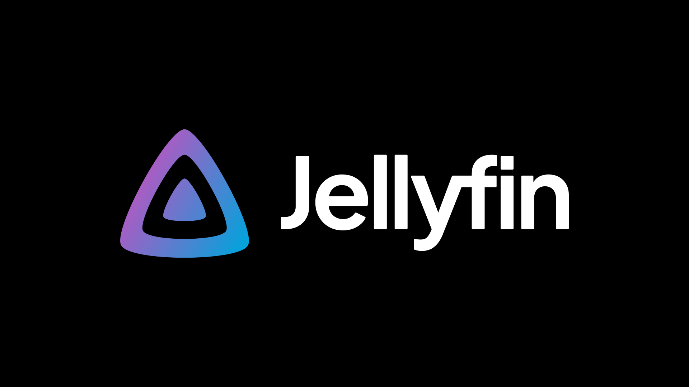
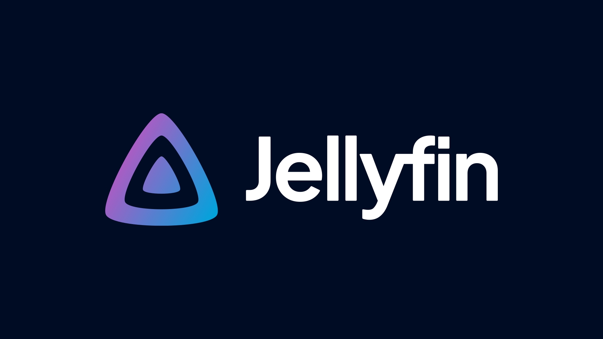
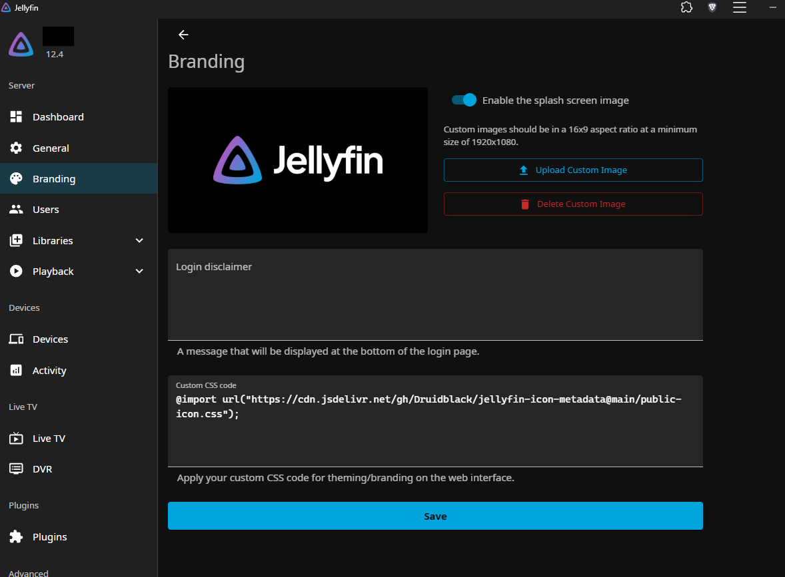

# splash-screens-for-jellyfin-server

Splash screen images for use in Jellyfin Server in the `Branding` section.

They are in `webp` format, available in two background colors (black or blue) for 3 different sizes: 4K (2160p), 2K (1440p) and 1K(1080p) at 16:9 ratio.

## Examples

# How to Use

Download the `RAR` or `ZIP` file in the Releases section, extract the archive and then configure like so:

_Dashboard > Branding in Jellyfin Server_

## Use of logo
The copyright and rights remain with official Jellyfin as per [jellyfin-ux](https://github.com/jellyfin/jellyfin-ux) and [Branding](https://jellyfin.org/docs/general/contributing/branding/). No claims to the logo are made.
